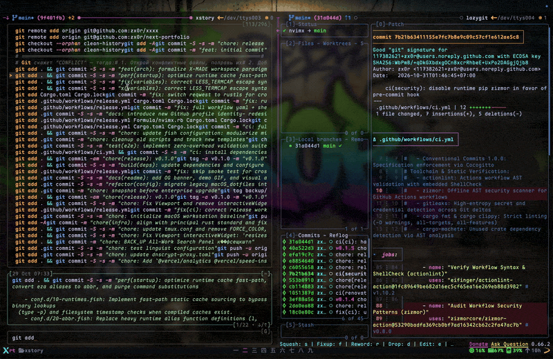

<p align="center">
  <a href="https://github.com/zx0r/linex/releases">
    
  </a>
  <a href="LICENSE-MIT">
    
  </a>
  <a href="https://www.rust-lang.org/">
    
  </a>
</p>

<p align="center">
  <a href="https://github.com/user-attachments/assets/808dbcbd-fad3-43f3-a6c9-788406c55331">
    
  </a>
</p>

---

### Installation

```bash
# Cargo (crates.io)
cargo install linex

# Homebrew (macOS / Linux)
brew install zx0r/tap/linex

# Build from source (LTO fat, stripped)
gh repo clone zx0r/linex
cd linex && just release
```

---

### Integration

```bash

# Tmux
set -g status-left '#(linex git)'
set -g status-right '#(linex cpu mem ssd)'
```

---

### [ l i n e x ]

<p align="center">
  
</p>

```shell
linex [WIDGET] [OPTIONS]

[✓] zero-allocation stack formatting
[✓] sub-millisecond telemetry probes
[✓] native tmux and ANSI dialects
[✓] zero runtime dependencies

fast telemetry → rendered instantly for tmux and status lines
```

---

### License

Dual-licensed under [MIT](LICENSE-MIT) or [Apache 2.0](LICENSE-APACHE).
